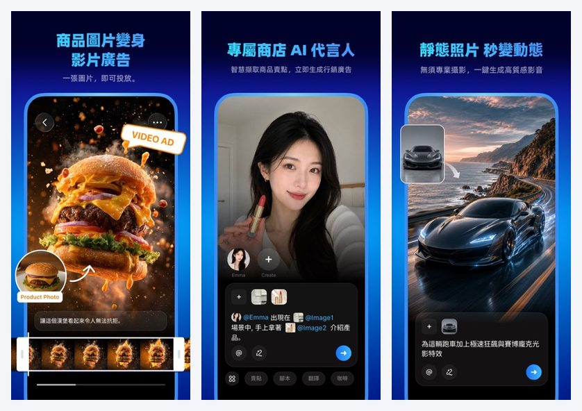
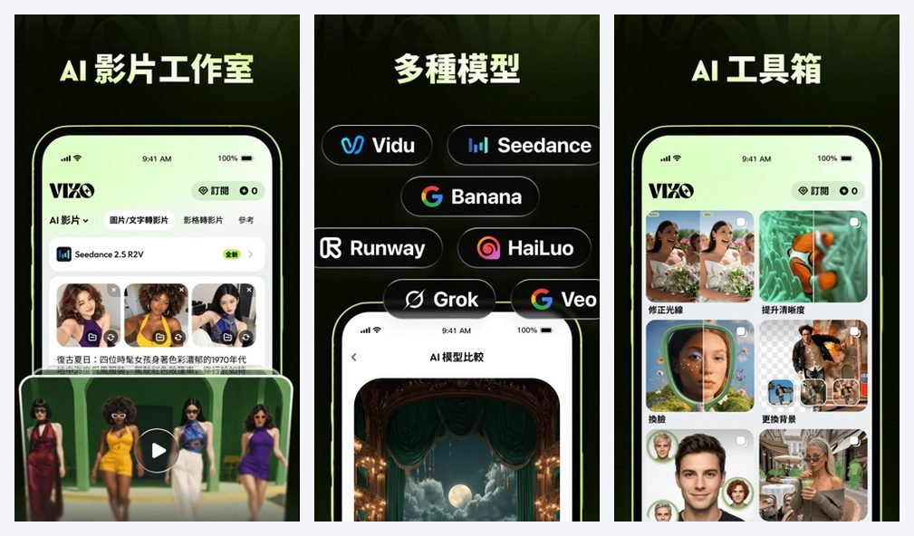
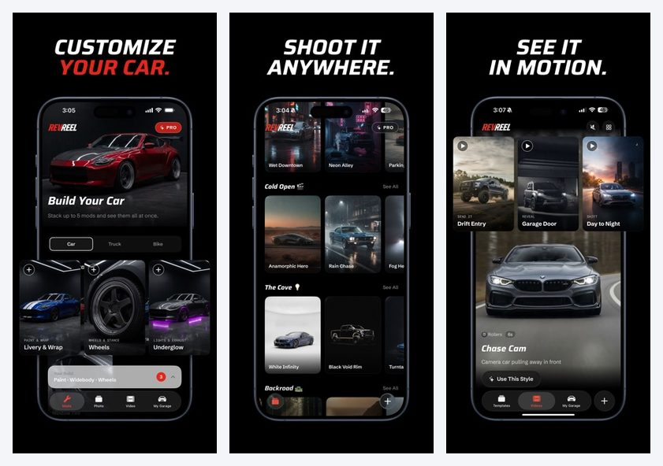
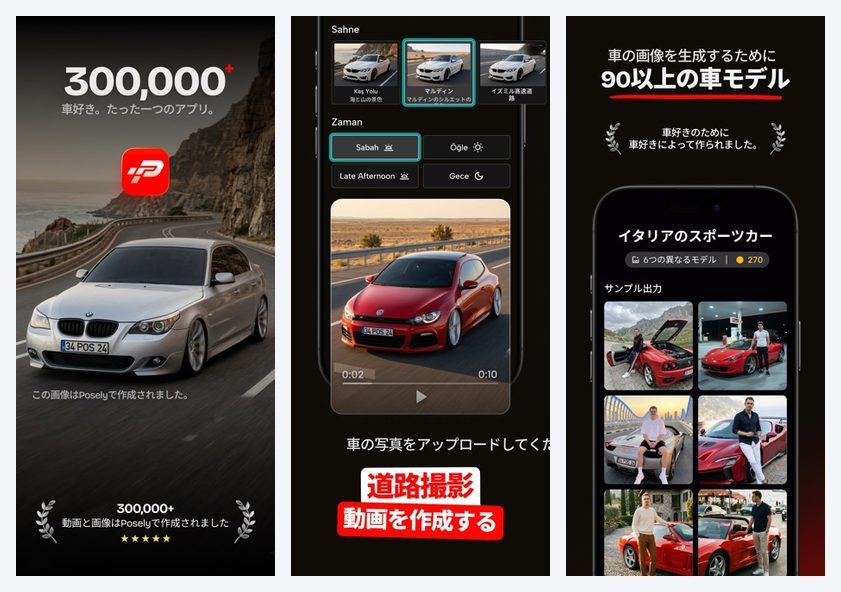
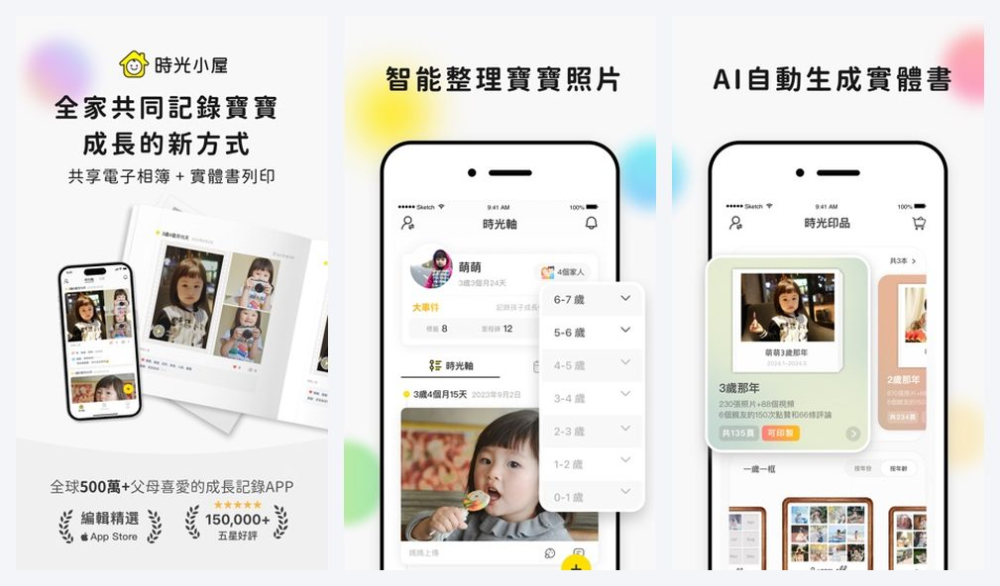
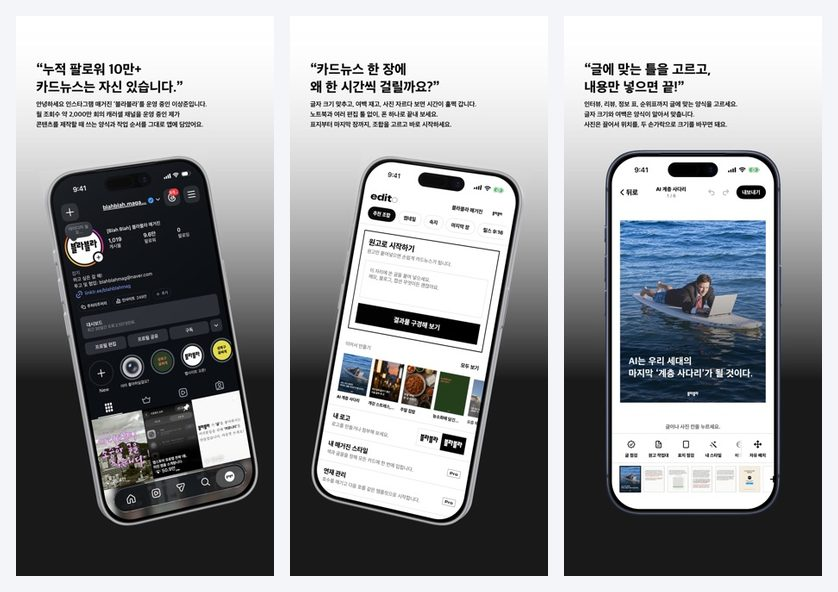
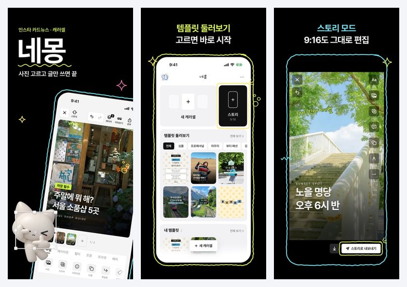

一杯手摇饮，放在柜台上，拍了一张照片。

传上去，等几十秒。杯子转起来，冰块晃了一下，镜头推近，旁边站出来一个不存在的人，替你说这杯有多好喝。

这是台湾一款叫 Kiva 的 App 在做的事。今年七月上架，四个月，五百多个评分，排在台湾摄影类畅销榜第十九。

我是翻榜单的时候看到它的。

## 我翻了什么

十一个市场：台湾、日本、韩国、香港、泰国、印尼、越南、马来西亚、新加坡、菲律宾，加上美国。

每个市场两张榜，设计类和摄影类的畅销榜，各取前一百。合起来两千一百九十八条。日期是 2026 年 11 月 13 日，只有这一天。

先说清楚这份数据做不到的事。它只有 iOS。它只是一天的快照，看不出谁在涨谁在跌。榜单位次不等于收入，小市场的第十名，可能赚不到大市场第八十名的零头。

所以下面的话，都只是位次，和我从位次里读出来的意思。

## 挤满的地方

通用的 AI 视频生成，每个市场的前一百里，少的十一个，多的二十七个。我是按名字里的关键词粗略数的。

室内设计，四到二十一个。越南那张榜上，前十六名里有七个是它。名字都差不多，Home AI，DecAI，Homely AI，Home Guru。同一批工作室，换个国家再上一遍。

纹身设计，多数市场都有。证件照，日本四个。动漫风格，日本八个。

这些地方不缺人。

## 没挤满的地方

我按“给谁用”把剩下的重新分了一遍。结果是这样的。

| 给谁 | 美国 | 日本 | 台湾 | 香港 | 韩国 |
|---|---|---|---|---|---|
| 车主 | 3 | 2 | 0 | 0 | 0 |
| 养宠物的人（AI 写真） | 0 | 0 | 0 | 0 | 0 |
| 新手父母（AI 写真） | 0 | 0 | 0 | 0 | 0 |
| 做小生意的人 | 未单独统计 | 1 | 1 | 1 | 1 |

数字是进入前一百的产品个数。分类是我按产品名字和说明手工归的，可能有漏。

空格不等于机会。没有产品，也可能是没有人要。

但有几格，值得多看一眼。

## 做小生意的人

*Kiva，台湾区 App Store 截图。版权归开发商 Artemis NovoCore Limited 所有。*

回到那杯手摇饮。

Kiva 的说明里点了名：手摇饮，咖啡，甜点，伴手礼，二手车行，租车。它不说自己是视频生成工具。它说，不用找网红，不用请演员，不用租摄影棚。

价钱也不是卖给普通人的价钱。周付新台币 320 到 390，月付 890，点数包最贵一档 2,490。

同一张榜上，排第六的是一个通用的 AI 视频工具，叫 VIXO。它也是七月上架的，在香港的设计类榜上排到了第二。它的评分是 3.8，二十一个人打的。

*VIXO，台湾区 App Store 截图。版权归开发商 NAVIEMU PTE. LTD 所有。*

两个都在榜上。一个卖“什么都能生成”，一个卖“你店里那杯饮料”。

我在 Meta 的广告库里查了 Kiva。返回的三十条里，二十九条是它的，用了两个主页在投。有一条是对着车商说的：预算不够拍广告片，排期等不到摄影棚。

它知道自己在跟谁说话。

## 车主

*RevReel，美国区 App Store 截图。版权归开发商 Applitude LLC 所有。*

美国有一款 RevReel，今年八月上架。拍一张自己的车，它给你换轮毂，换颜色，放到雨夜的街上，再动六秒。周付 9.99 美元。排在美国设计类畅销榜第四十。

它在 Meta 上有二十九条在投的广告。我看了其中三条，文案的开头一模一样，只换了画面。

日本是改装车的老家。日本那张榜上，这个方向排最高的叫 Posely，第七十三名。开发商在土耳其。商店里的说明，还是英文。

*Posely，日本区 App Store 截图。版权归开发商 BROVERSE 所有。*

台湾、香港、韩国，前一百里一个都没有。

## 新手父母

所有十一个市场，没有一款给宝宝做 AI 写真的产品进榜。

但台湾摄影类畅销榜的第八名，是一个宝宝相册，叫时光小屋。2012 年上架，六万一千多个评分，一年大约新台币 950。它自己的介绍里写，每五个台湾妈妈，有两个在用。这句话是它说的，我没法核实。

*时光小屋，台湾区 App Store 截图。版权归开发商 Bithouse, Inc. 所有。*

它不是 AI 产品。我把它放在这里，只为了一件事：父母愿意为孩子的照片付钱，付了十几年。

至于他们愿不愿意为“生成出来的”孩子的照片付钱，我不知道。这里还牵涉到孩子的肖像和隐私。这一格，我只敢写成一个问号。

## 韩国的一个小东西

韩国设计类畅销榜的第四名和第十名，是两个做“卡片新闻”的工具，Edito 和 네몽。

卡片新闻是韩国 Instagram 上的一种体裁，一组图，一张一句话，往左滑着看。这两个 App 就干一件事：帮你把这组图排得像杂志。

*Edito，韩国区 App Store 截图。版权归开发商 SANGSANGLYEOG 所有。*

Edito 十一月四日才上架，月付 9,900 韩元。它的副标题是：一个十万粉丝的 Instagram 杂志主理人的经验。

*네몽，韩国区 App Store 截图。版权归开发商 ohttne 所有。*

네몽 便宜得多，月付 3,300 韩元。

这两个里面几乎没有“生成”。它们卖的是版式，是一个人做了很多遍之后留下来的手感。

## 我读出来的意思

通用的那一层，模型是别人的，谁都接得上。于是榜上挤着二十个长得一样的名字。

往下走一层，换了问法。不问“你想生成什么”，问“你是开饮料店的，还是开车行的”。

这一层卖的东西，其实不是图。是省掉的那个摄影棚，是车主想发到群里的那六秒，是一个主理人排了很多遍的版。

模型只是把这些东西变便宜了。

会生图不值钱。知道这张图是给谁的，值钱。

## 出处

- 榜单数据：App Store 各市场设计类、摄影类畅销榜前一百，抓取于 2026 年 11 月 13 日。
- 商店页面：[Kiva](https://apps.apple.com/tw/app/kiva-ai%E5%95%86%E5%93%81%E5%BD%B1%E7%89%87%E8%88%87%E5%BB%A3%E5%91%8A%E7%94%9F%E6%88%90%E5%99%A8/id6761752130)、[VIXO](https://apps.apple.com/tw/app/vixo-ai%E5%BD%B1%E7%89%87%E7%94%9F%E6%88%90-%E5%BD%B1%E7%89%87%E8%A3%BD%E4%BD%9C/id6789399947)、[Posely](https://apps.apple.com/jp/app/posely-ai%E6%84%9B%E8%BB%8A%E3%82%B9%E3%82%BF%E3%82%B8%E3%82%AA/id6754215685)、[RevReel](https://apps.apple.com/us/app/revreel-ai-car-edits/id6800568794)、[时光小屋](https://apps.apple.com/tw/app/%E6%99%82%E5%85%89%E5%B0%8F%E5%B1%8B-%E5%AF%B6%E5%AF%B6%E6%88%90%E9%95%B7%E7%9B%B8%E7%B0%BF/id565951606)、[Edito](https://apps.apple.com/kr/app/edito-%EC%98%AC%EC%9D%B8%EC%9B%90-%EC%B9%B4%EB%93%9C%EB%89%B4%EC%8A%A4-%EC%A0%9C%EC%9E%91-%ED%88%B4/id6828561686)、[네몽](https://apps.apple.com/kr/app/%EB%84%A4%EB%AA%BD-%EC%B9%B4%EB%93%9C%EB%89%B4%EC%8A%A4-%EB%A7%8C%EB%93%A4%EA%B8%B0-%EC%BA%90%EB%9F%AC%EC%85%80/id6817196863)。评分数、定价、上架日期均取自商店页面。
- 广告：Meta 广告库，[Kiva](https://www.facebook.com/ads/library?id=1813990499727807)、[RevReel](https://www.facebook.com/ads/library?id=915120114803818)、[Posely](https://www.facebook.com/ads/library?id=1927290857976064)。每个关键词只取了返回的前三十条。
- 文中截图版权归各自开发商所有，仅作评论引用。
